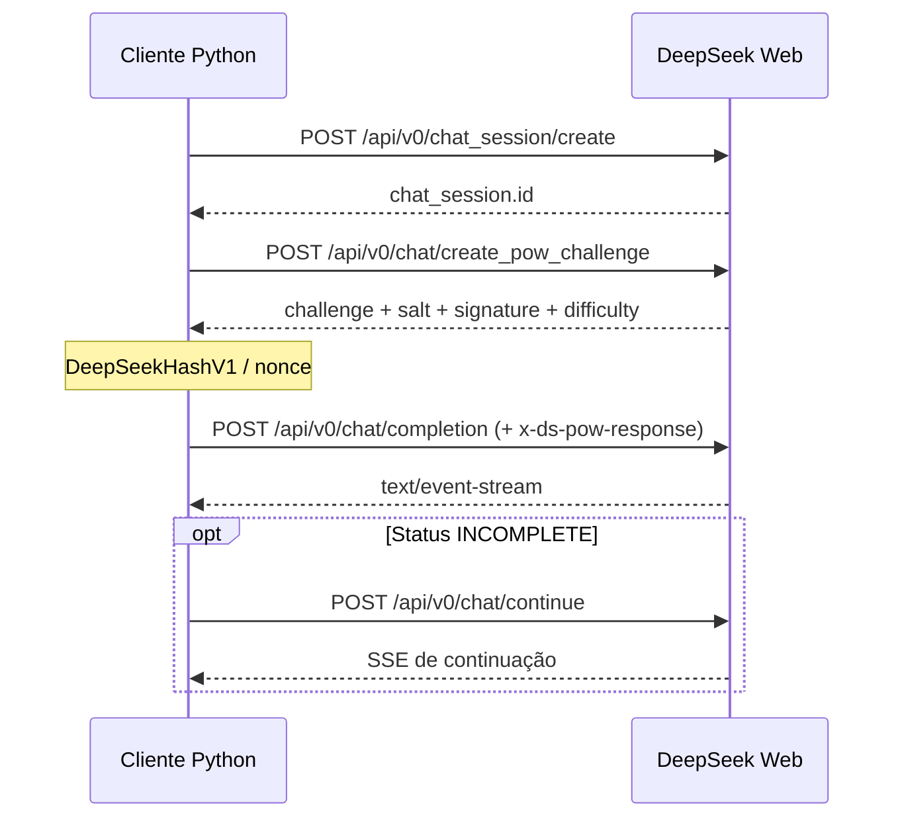

# Protocolo HTTP observado

Este documento descreve o comportamento implementado do **serviço privado DeepSeek Web**, observado por engenharia reversa. Não é contrato oficial do fornecedor. O cliente usa exclusivamente HTTPS e não inicia navegador.

## Topologia e sequência



Uma sessão existente pula a etapa de criação de sessão. A continuação de geração `/chat/continue` usa o ID da resposta, não um novo prompt.

## 1. Autenticação e identificação

Todas as chamadas protegidas recebem `Authorization: Bearer <token>`. Outros cabeçalhos configurados pelo cliente incluem `User-Agent`, `Referer`, `x-client-bundle-id: com.deepseek.chat`, `x-client-locale`, `x-client-platform: web`, `x-client-timezone-offset`, `x-client-version: 2.7.0`, `x-device-id` e, se disponível, `x-hif-leim`. O cliente aceita cookies da sessão.

A importação offline opcional valida token com `GET /api/v0/users/current`. Esse endpoint é utilizado pelo importador, não pelo fluxo normal de geração.

## 2. Criação de conversa

`POST https://chat.deepseek.com/api/v0/chat_session/create`

```json
{}
```

A resposta é encapsulada pelo servidor em `code/data/biz_data`; `client.create_chat_session()` extrai `chat_session`, incluindo `id`. O cliente trata erros HTTP, `code` e `biz_code`.

## 3. Desafio de PoW

`POST https://chat.deepseek.com/api/v0/chat/create_pow_challenge`

```json
{"target_path":"/api/v0/chat/completion"}
```

Do objeto `challenge`, o cliente usa: `algorithm`, `challenge` (hex com 32 bytes), `salt`, `expire_at`, `difficulty`, `signature`, `target_path`.

Para `DeepSeekHashV1`, tenta o menor inteiro `answer` no intervalo `[0, difficulty)` que satisfaz:

```text
DeepSeekHashV1(UTF8(salt + "_" + expire_at + "_" + answer))
    == bytes.fromhex(challenge)
```

A função aplica o padding SHA3-256 (domínio `0x06`, taxa 136 bytes), mas a permutação Keccak-f[1600] executa **as rodadas 1 a 23, omitindo a rodada 0**. Portanto **não é idêntica** a `hashlib.sha3_256`.

O solver C oferece aceleração e há fallback Python. O resultado é serializado como JSON com `algorithm`, `challenge`, `salt`, `answer`, `signature`, `target_path`; então Base64 e enviado no cabeçalho `x-ds-pow-response`.

## 4. Início de geração

Antes da geração, a chamada pode carregar mídias e produzir os IDs em `ref_file_ids`. O fluxo de anexos é:

```text
POST /api/v0/chat/create_pow_challenge
    {"target_path":"/api/v0/file/upload_file"}
POST /api/v0/file/upload_file
    multipart(file), x-ds-pow-response, x-file-size,
    x-model-type, x-thinking-enabled
GET /api/v0/file/fetch_files?file_ids=ID
    repetir até files[0].status = SUCCESS
POST /api/v0/chat/completion
    {"ref_file_ids":["ID"], ...}
```

O upload usa seu **próprio** desafio PoW, diferente do desafio associado ao endpoint de geração. O resultado do POST contém `data.biz_data.id`. O polling admite estados transitórios como `PENDING` e `PARSING`; falhas e tempo excedido são erros explícitos. A implementação não converte arquivo em Base64 no corpo do prompt.

Detalhes: [Mídias e arquivos](MIDIAS.md). A API pública `api.deepseek.com` não deve ser confundida com essas rotas privadas do site.

`POST https://chat.deepseek.com/api/v0/chat/completion`

```json
{
  "chat_session_id": "UUID",
  "parent_message_id": null,
  "model_type": "default",
  "prompt": "Olá",
  "ref_file_ids": [],
  "thinking_enabled": false,
  "search_enabled": true,
  "action": null,
  "preempt": false
}
```

`parent_message_id` pode ser o ID de uma mensagem da conversa existente. O cabeçalho de PoW gerado para esse caminho é obrigatório no fluxo implementado. O servidor normalmente retorna `Content-Type: text/event-stream`, que o cliente consome incrementalmente.

## 5. Continuar resposta incompleta

`POST https://chat.deepseek.com/api/v0/chat/continue`

```json
{
  "chat_session_id": "UUID",
  "message_id": 2,
  "fallback_to_resume": true
}
```

Reutiliza a mensagem do assistente em geração; não cria outra mensagem do usuário. Não executa novo PoW no método atual. O corpo `message_id` vem do `ready.response_message_id` ou da resposta acumulada.

## Invariantes e evolução

- Endpoint e formato foram observados, não publicados como API pública estável.
- Campos experimentais podem mudar; `model_type=default` não identifica uma versão fixa de modelo.
- Cabeçalhos de identidade são emulados conforme o protocolo observado; isso não equivale a executar um browser.
- Uma resposta HTTP 200 pode conter erro lógico JSON em vez de SSE; o cliente confere ambos.
- Este repositório é um **cliente HTTP**, não um proxy OpenAI-compatible nem um servidor escutando porta.
