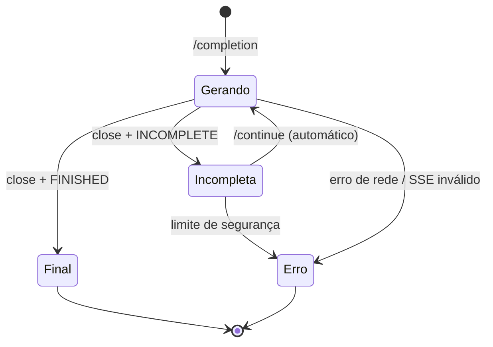

# Streaming SSE, thinking e continuidade

## Eventos recebidos e transformação

Quando a geração usa `attachments`, o cliente aguarda o processamento de cada arquivo **antes** de iniciar o SSE de geração. Para cada arquivo carregado, `stream_completion()` emite `StreamChunk(event="file", filename=..., file_id=..., status="SUCCESS")`. No formato JSONL, isso corresponde a `{"type":"file","filename":"...","file_id":"...","status":"SUCCESS"}`. O evento final `done` inclui a lista `file_ids`; um erro de upload/parse interrompe o fluxo antes da geração.

A resposta de `/chat/completion` e `/chat/continue` usa **Server-Sent Events (SSE)**. `iter_sse()` separa `event:`/`data:` a cada linha em branco. `CompletionAccumulator.feed()` reconstrói patches incrementais do servidor, que podem conter:

- `ready`: `request_message_id`, `response_message_id`.
- `title`: título da conversa.
- `message`: objeto completo ou patch com `p` (caminho), `o` (operação), `v` (valor).
- `close`: fim daquele segmento SSE.
- `error`: erro convertido em exceção.
- `[DONE]`: marca terminal reconhecida pelo parser, quando presente.

Os fragments `THINK`, `THINKING` e `REASONING` formam o texto de raciocínio; os fragments `RESPONSE`, a resposta. O servidor pode trocar de THINK para RESPONSE por `APPEND` na lista `response/fragments` e passar a omitir o caminho de novos pedaços. O acumulador acompanha o caminho implícito `response/fragments/-1/content` para não perder texto.

## Reconstrução sem repetição

Duas strings independentes representam conteúdo já **entregue** ao consumidor: `_emitted_text` e `_emitted_thinking`. Para cada novo snapshot acumulativo, apenas o sufixo após esse prefixo é emitido. Se `/continue` reenviar snapshot vazio ou antigo, o prefixo emitido não é zerado; ele aguarda a reconvergência do snapshot para evitar repetições. Isso é controle append-only: uma eventual reescrita não prefixada pelo servidor não pode ser representada fielmente como deltas append-only.

## Máquina de estados da geração



- `auto_continue=True` por padrão. `INCOMPLETE` dispara outra requisição automaticamente até `FINISHED`.
- `max_continue_attempts=20` é proteção contra loops; se excedido, **lança erro**, não reporta sucesso.
- `StreamChunk(event="continue", attempt=N)` marca cada retomada; a CLI emite `{"type":"continue","attempt":N}`.
- Em JSONL, há exatamente um `done` ao final de `chat()` bem-sucedido; em erro, a execução termina sem `done`.
- Ao desligar a retomada com `--no-auto-continue`, uma saída parcial pode finalizar com status `INCOMPLETE` de forma intencional.

## Retomar uma sessão existente

Uma nova chamada `chat(prompt, chat_session_id=UUID, parent_message_id=ID)` usa o histórico mantido pelo servidor, inicia nova mensagem e obtém novo desafio PoW. Isso **não** é o endpoint `/chat/continue`. Para ramificações, selecione o pai correto.

## Interface programática

```python
from api_client import DeepSeekClient

cli = DeepSeekClient()
sessao = cli.create_chat_session()
for part in cli.stream_completion(
    chat_session_id=sessao["id"],
    prompt="Explique a teoria dos grafos.",
    thinking_enabled=True,
):
    if part.thinking:
        print("[thinking]", part.thinking, end="")
    if part.text:
        print(part.text, end="", flush=True)
    if part.event == "continue":
        print("\n[continuação automática]", part.attempt)
```

Para resultado agregado e metadados de saída, use `client.chat()`. A chamada de baixo nível deixa os dados finais em `client.last_accumulator`.

## Observabilidade

A CLI `--stream` oferece `file` (com anexos), `thinking`, `text`, `title`, `continue` e `done` em JSONL, separados por linha e imediatamente descarregados. A opção `--show-thinking` usa stderr no modo texto comum; evite persistir raciocínio sem necessidade.
